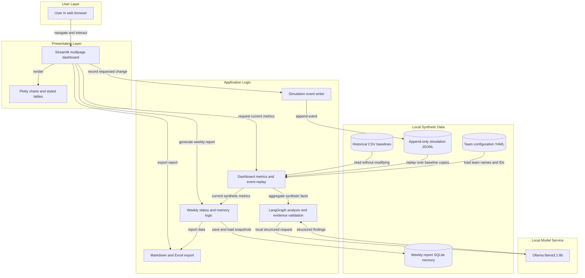
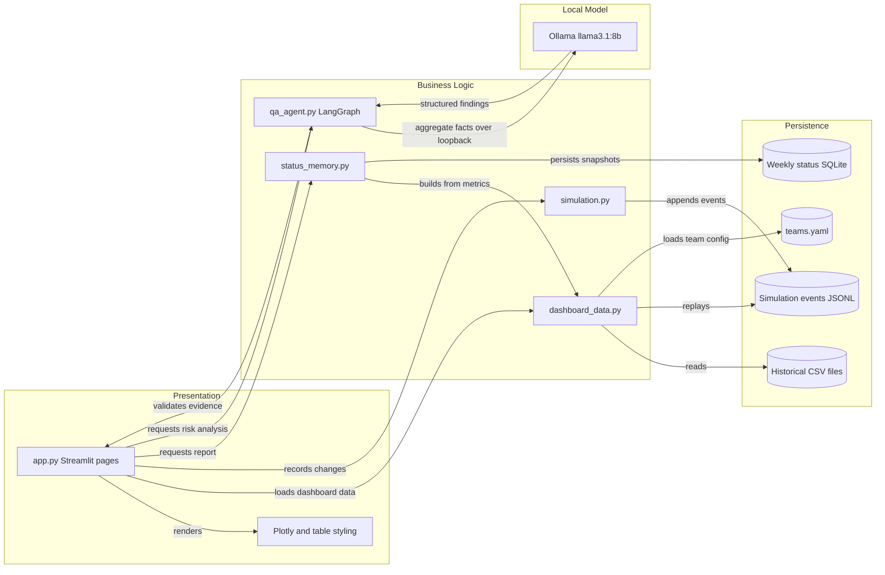

# Architecture Diagram

TestPulse AI is a local-first Streamlit dashboard for synthetic QA portfolio data. Its AI workflow uses a local Ollama model to produce evidence-grounded risk findings; it does not give the model tools to call or permission to change project data.

For a larger, zoomable view, open [the AI analysis demo flow](./ai-analysis-demo-flow.svg) or [the application architecture diagram](./application-architecture.svg). A spoken walkthrough is available in the [demo script](./demo-script.md).

## Instructor-Style AI Analysis Flow

This six-step view follows the instructor's tool-calling diagram format while reflecting the actual project: the model proposes structured findings, and host application code validates them and constructs the factual summary. No Python tool is exposed to or executed by the model.

```mermaid
flowchart LR
    subgraph stepOne["1. Load synthetic QA data"]
        sourceData["Baseline CSV files, team YAML, simulation events"]
        sourceOutput["Output: replayed current data"]
        sourceData -->|"read and replay"| sourceOutput
    end
    subgraph stepTwo["2. User requests analysis"]
        userAction["User selects Run Portfolio Analysis"]
    end
    subgraph stepThree["3. Host builds model request"]
        prepareFacts["Calculate team and sprint metrics"]
        prepareOutput["Output: aggregate facts and evidence IDs"]
        prepareFacts -->|"exclude issue details"| prepareOutput
    end
    subgraph stepFour["4. Local model generates findings"]
        localModel["Ollama with llama3.1:8b"]
        modelOutput["Output: structured risk findings"]
        localModel -->|"return findings"| modelOutput
    end
    subgraph stepFive["5. Host validates and summarizes"]
        findingCheck["LangGraph validates team and evidence references"]
        factualSummary["Python builds summary from current metrics"]
    end
    subgraph stepSix["6. Display analysis report"]
        finalReport["Factual summary, ranked findings, evidence, suggested actions"]
    end

    sourceOutput -->|"current portfolio data"| prepareFacts
    userAction -->|"run analysis"| prepareFacts
    prepareOutput -->|"aggregate-only local request"| localModel
    modelOutput -->|"structured response over loopback"| findingCheck
    findingCheck -->|"validated findings"| finalReport
    factualSummary -->|"validated analysis"| finalReport
```

<!-- mermaid-checked: no \n, no em-dash/en-dash, no {} in labels, subgraphs are id["label"], arrows are -->|"label"|, all subgraphs closed by end, ids unique -->

## Application Architecture

The application separates the Streamlit presentation, synthetic-data and reporting logic, local file-based persistence, and local model service. Historical data remains read-only during simulation; current views are computed by replaying the append-only event log.

<!-- mermaid-checked: no \n, no em-dash/en-dash, no {} in labels, subgraphs are id["label"], arrows are -->|"label"|, all subgraphs closed by end, ids unique -->

### Technology Stack Summary

| Layer | Technology | Version | Purpose |
|---|---|---|---|
| User interface | Streamlit | `>=1.49,<2` | Multipage interactive dashboard and forms |
| Charts | Plotly Express and Plotly Graph Objects | `>=5.20,<7` | Portfolio comparisons and sprint trends |
| Data processing | Python and pandas | Python 3.13 tested; pandas `>=2.2,<3` | Load synthetic CSVs, replay events, and compute metrics |
| Configuration | YAML and PyYAML | PyYAML `>=6,<7` | Configure the four synthetic QA teams |
| Agent workflow | LangGraph | `>=1,<2` | Run model analysis and evidence-validation nodes |
| Local model client | LangChain Ollama | `>=1,<2` | Request structured findings from local Ollama |
| Local language model | Ollama `llama3.1:8b` | Local installation | Generate risk findings and human-review recommendations |
| Weekly memory | SQLite | Python standard library | Persist weekly synthetic status snapshots |
| Excel export | openpyxl | `>=3.1,<4` | Write formatted downloadable report workbooks |
| Automated tests | pytest | `>=8,<10` | Validate data, metrics, simulations, reports, and UI behavior |

### Data Storage & External Services

The application reads synthetic historical CSVs and team settings from local files. Simulation changes are appended to a JSONL event log and replayed against copies of the baseline records; the baseline CSVs are not rewritten. Weekly status snapshots are stored locally in SQLite, and downloadable reports are generated as Markdown or Excel. The AI integration connects only to an Ollama service on the local machine over loopback HTTP. There are no company Jira or Zephyr connections, remote model endpoints, cloud databases, caches, or message brokers.

### Key Architectural Decisions

- Keep business logic in `scripts/` modules and use `app.py` for Streamlit page rendering and user interactions.
- Treat historical CSVs as immutable inputs; simulate current-state changes through append-only events and replay.
- Send aggregate synthetic metrics to the local model; calculate the factual summary in Python, validate team-specific evidence references, and leave final review of model recommendations to the user.

## Component Relationships

The component view shows which modules own presentation, metric calculation, persistence, simulation, weekly memory, and AI analysis. The model can return findings but has no tool interface to the application or data stores.

<!-- mermaid-checked: no \n, no em-dash/en-dash, no {} in labels, subgraphs are id["label"], arrows are -->|"label"|, all subgraphs closed by end, ids unique -->

### Component Inventory

| Component | Layer | Type | Responsibility |
|---|---|---|---|
| `app.py` | Presentation | Streamlit application | Navigation, page rendering, user input, and report downloads |
| `scripts/dashboard_data.py` | Business logic | Data and metrics module | Load CSVs and team YAML, replay events, and compute current and sprint metrics |
| `scripts/simulation.py` | Business logic | Event-writing module | Validate requested synthetic status changes and append replayable events |
| `scripts/status_memory.py` | Business logic | Reporting and persistence module | Build deterministic weekly status reports and save or retrieve SQLite snapshots |
| `scripts/qa_agent.py` | Business logic | LangGraph workflow | Prepare aggregate facts, request local model findings, validate evidence, and generate the factual summary |
| `scripts/table_styling.py` | Presentation support | Styling module | Apply consistent status and readiness styling to dashboard tables |
| Plotly | Presentation | Charting library | Render team comparison and sprint trend charts |
| Historical CSV files | Data | Immutable synthetic baseline | Store sprints, issues, test cases, cycles, executions, snapshots, and dependencies |
| `data/simulations/events.jsonl` | Data | Append-only event log | Store simulation events that are replayed over baseline copies |
| `data/status_memory.sqlite3` | Data | Local SQLite database | Persist weekly status snapshots for historical comparisons |
| `config/teams.yaml` | Configuration | YAML settings | Define synthetic team IDs, names, project keys, and domains |
| Ollama `llama3.1:8b` | Local model service | Structured-output LLM | Generate evidence-grounded risk findings and suggested actions; it cannot call application tools |
